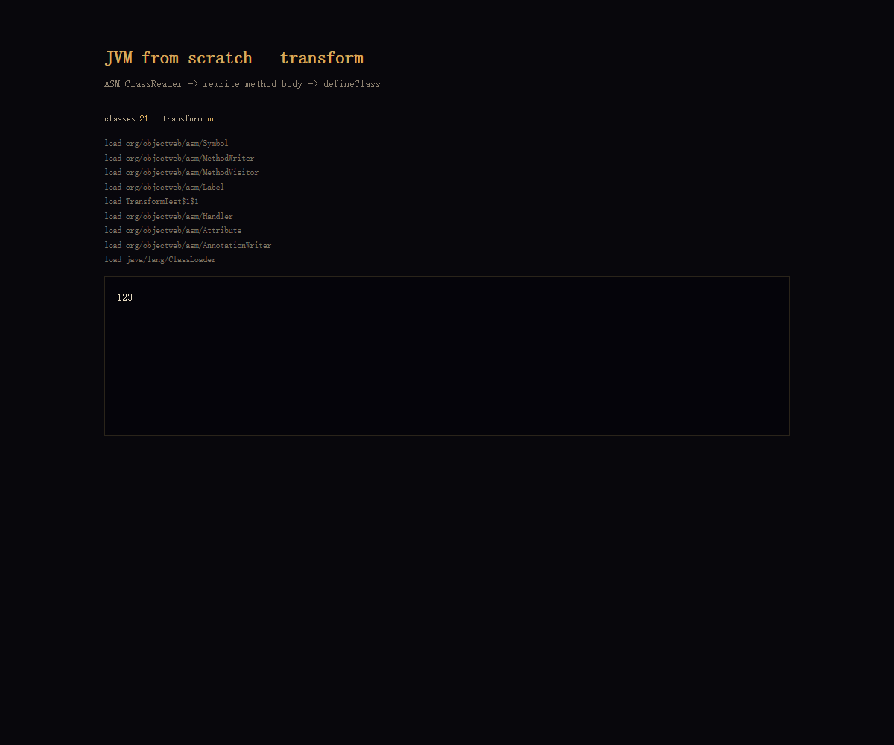
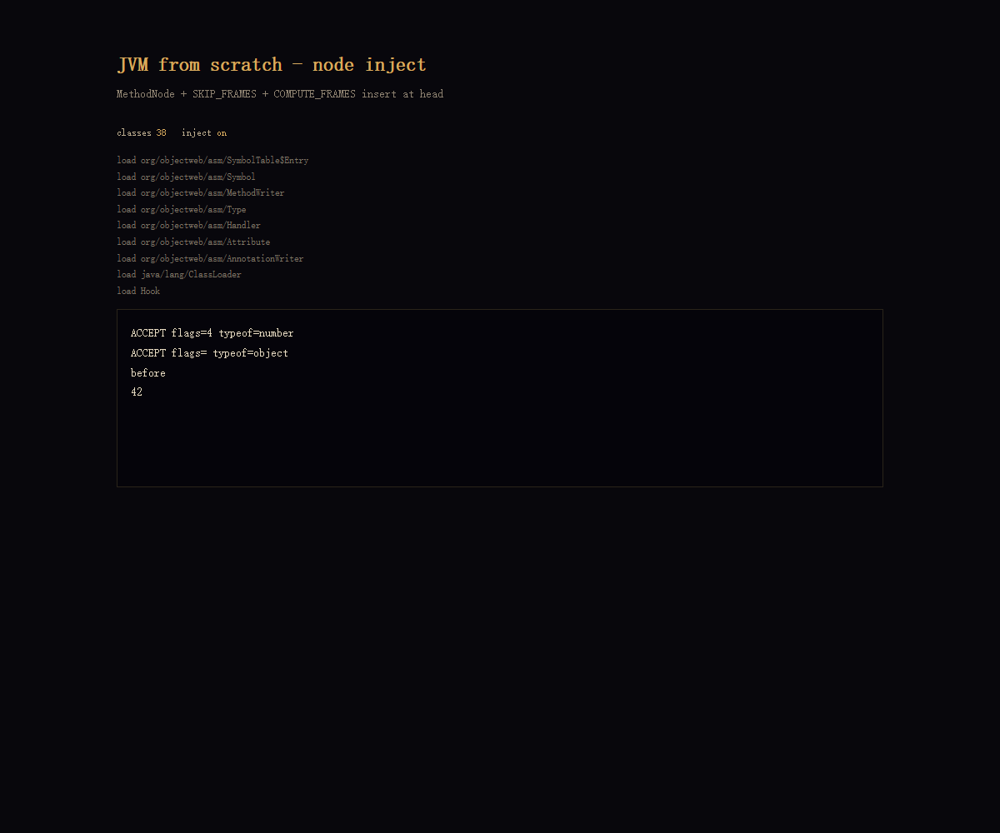
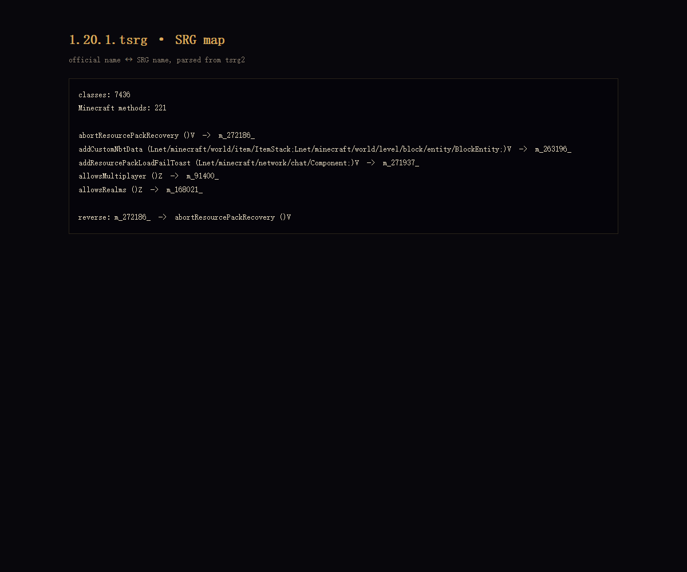

# Demo / playground

There is **no hosted editor yet**. The current playground executes precompiled class files; it does not compile Java source in the browser.

## Run locally

```powershell
powershell -ExecutionPolicy Bypass -File scripts/setup.ps1
powershell -ExecutionPolicy Bypass -File scripts/build.ps1
node scripts/serve.mjs
```

Open:

```
http://127.0.0.1:5193/
```

## Stable check

The only check treated as stable in this phase is the Mixin harness:

```powershell
node lab/run-realmixin.mjs
```

Expected:

```text
real mixin HEAD
real mixin RETURN
42
```

## Pages worth opening

The `lab/` directory contains the historical playground. Some pages depend on fixtures that are compiled separately and may not work after a clean checkout.

| Page | What it shows |
|------|---------------|
| `real.html` | real `java.base` classes |
| `list.html` | `ArrayList` |
| `str.html` | strings / `StringBuilder` |
| `exception.html` | `athrow`, exception table |
| `generic.html` | generic signatures |
| `anno.html` | annotations |
| `asm.html` | ASM loaded by the runtime |
| `transform.html` | ASM method rewrite (`42 → 123`) |
| `node.html` | MethodNode HEAD/RETURN injection |
| `srg.html` | SRG mapping table |
| `srgtest.html` | SRG fallback |
| `modern.html` | shader + VBO |
| `pngindex.html` | PNG + index buffer |
| `rotate.html` | matrix uniform |

## Screenshots







## What is still missing

- a source editor and server-side compilation
- a sandboxed iframe for untrusted class files
- a hosted demo with the runtime assets served from a CDN
- reproducible fixtures for every historical page

The roadmap tracks these in [`roadmap.md`](roadmap.md).
